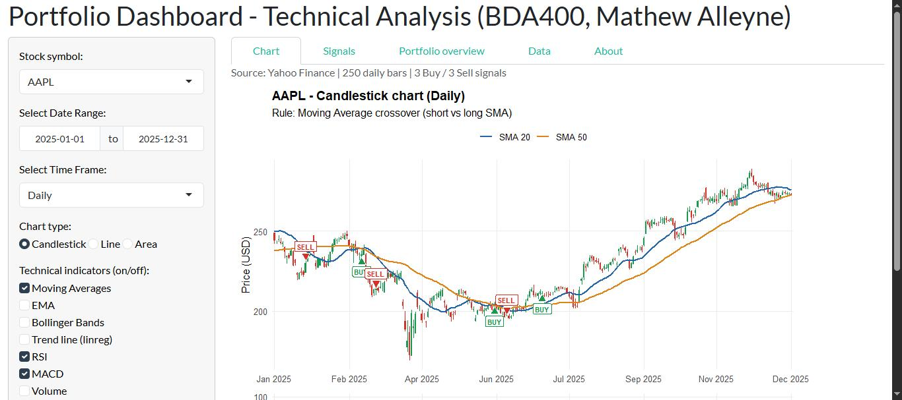

# Assignment 6 – Technical Analysis using R, Visualization Phase

| | |
|---|---|
| **Name** | Mathew Alleyne (Student ID 664429889) |
| **Course** | BDA400 – Data Science Tools and Techniques |
| **Assignment** | Assignment 6 – Technical Analysis using R, Visualization Phase |
| **Repository** | https://github.com/MathewAlleyne-crypto/TechnicalAnalysis/tree/main/Assignment6 |

## Project description

This is an interactive **portfolio dashboard** written in R Shiny. It is the third stage of the project:

- **Data:** it downloads stock prices from **Yahoo Finance** with `quantmod`, for the portfolio from Assignment 2 (AAPL, MSFT, GOOGL, AMZN, TSLA) or any ticker you type.
- **Charts:** it shows the prices as a **candlestick, line or area chart**, for any date range, with a **daily, weekly or monthly** time frame.
- **Indicators:** you can switch each technical indicator on and off. They are the base-R functions written in Assignment 5: moving averages, EMA, Bollinger Bands (`stdev`), a linear-regression trend line (`linreg`), RSI, MACD and volume.
- **Trading rules:** you can choose one of four rules. All periods and thresholds can be changed with sliders. The **Buy / Sell** bars are marked on the chart.
- **Results:** it lists the signals and back-tests the chosen rule against buy-and-hold. An overview table covers the whole portfolio.

## How to run

1. Install R (4.x) and, ideally, RStudio.
2. Open `app.R` and click **Run App**, or run `shiny::runApp("Assignment6")` from the repository folder. Missing packages (`shiny`, `ggplot2`, `quantmod`, `patchwork`, `bslib`) are installed automatically the first time.
3. Pick a symbol, a date range, a time frame, a chart type, indicators and a trading rule in the sidebar.

`Rscript make_screenshots.R` (run inside this folder) recreates the example charts in `screenshots/` without opening the app. It also checks that every Buy/Sell label sits exactly on a moving-average crossover.

## How the code maps to the assignment steps

| Step in the brief | Where in `app.R` |
|---|---|
| **1 – Data collection and setup**: packages, Yahoo Finance via `getSymbols()`, error handling, offline fallback to `stock_data_2025.csv` | section `STEP 1` (`fetch_stock()`) |
| **2 – Visualizing stock data**: Shiny skeleton, date range / time frame / chart type widgets, ggplot2 line / candlestick / area | `STEP 2` helpers, `build_chart()`, `ui`, `server` |
| **3 – Overlay technical indicators**: each indicator is a separate layer or panel, toggled with the *Technical indicators* checkboxes | `STEP 3` (`add_indicators()`), `build_chart()` |
| **4 – Trading rules and annotations**: 4 rules, Buy / Sell / Hold per bar, labels on the bars, back-test | `STEP 4` (`generate_signals()`, `backtest()`), annotations in `build_chart()` |

### Trading rules

A rule marks a bar **Buy** or **Sell** on the bar where its condition starts. All other bars are **Hold**. Signals alternate, so a repeat of the previous signal is ignored.

| Rule | Buy | Sell |
|---|---|---|
| Moving Average crossover | short SMA crosses above long SMA | short SMA crosses below long SMA |
| RSI | RSI rises back above the oversold level (30) | RSI falls back below the overbought level (70) |
| MACD | MACD crosses above its signal line | MACD crosses below its signal line |
| Combined | MACD crosses up **and** RSI < 70 **and** price above the long SMA | MACD crosses down **or** RSI falls below 70 |

## Files

| File / folder | Content |
|---|---|
| `app.R` | the complete Shiny dashboard, organised in sections for Steps 1–4 |
| `indicators/` | the Assignment 5 indicator functions (`sma.R`, `ema.R`, `macd.R`, `stdev.R`, `linreg.R`, `rsi.R`, `stoch_rsi.R`, `crossover.R`, `crossunder.R`) |
| `portfolio.txt` | portfolio symbols (same as Assignment 2) |
| `stock_data_2025.csv` | saved 2025 prices, used automatically if Yahoo Finance cannot be reached |
| `make_screenshots.R` | renders the example charts and checks the signal logic |
| `make_screenshots_output.txt` | output of that script |
| `screenshots/` | example charts and screenshots of the running app |
| `MathewAlleyne_BDA400_A06.docx` | cover page and short report |

## Example output (2025, default parameters)

| Example | Bars | Buy | Sell | Strategy | Buy & hold |
|---|---|---|---|---|---|
| AAPL, candlestick, daily, MA crossover | 250 | 3 | 3 | +13.9% | +11.5% |
| MSFT, line, weekly, combined rule | 53 | 2 | 3 | +8.9% | +14.2% |
| TSLA, area, daily, RSI rule | 250 | 1 | 1 | +16.8% | +18.6% |
| GOOGL, candlestick, daily (Sep–Dec), MACD rule | 85 | 2 | 3 | +12.2% | +48.1% |

The back-test is a simple long-only illustration for this assignment. It is not investment advice.
